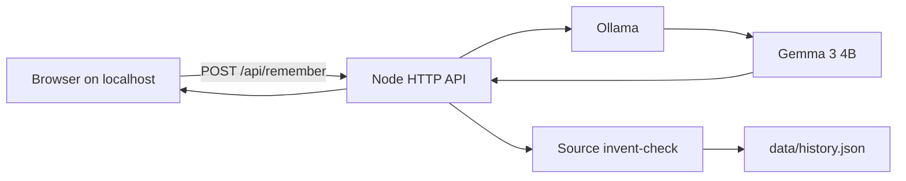

# Candela

A private digital ofrenda for Hacktoberfest Open-Source AI Challenge Week 4: **Ghost in the Machine**.

You bring a name, foods, songs, and short true stories. **Gemma 3 4B** runs through **Ollama on localhost**, writes a remembrance, and Candela rejects drafts that invent details that were never in your notes.

## Why this exists

Family memory is not a chatbot prompt. A hosted model would take the most private text you have. Candela binds to loopback, keeps history in a local JSON file, and treats invention as a bug.

## Requirements

- Node 22+
- [Ollama](https://ollama.com) running locally
- Model: `gemma3:4b` (default)

```bash
ollama pull gemma3:4b
```

## Run

```bash
npm start
```

Open http://127.0.0.1:8790

Optional env:

- `OLLAMA_HOST` (default `http://127.0.0.1:11434`)
- `OLLAMA_MODEL` (default `gemma3:4b`)
- `PORT` (default `8790`)

## Verify

```bash
npm test
npm run smoke
```

`smoke` calls the real local model with the sample abuela notes.

## Architecture



## License

MIT
