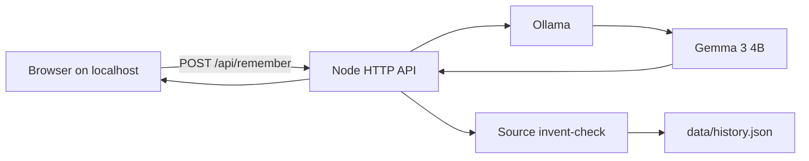

*This is a submission for the [Hacktoberfest Open-Source AI Challenge Week 4: Ghost in the Machine](https://dev.to/challenges/hacktoberfest-week4-2026-10-26)*

## What I Built

Candela is a private digital ofrenda. You bring a name, foods, songs, and short true stories. Gemma 3 4B, running through Ollama on your machine, writes a remembrance and a list of offerings. A source invent-check rejects drafts that invent details that were never in your notes, then asks the model once more. If the second draft still invents, Candela refuses to light the altar.

The people it is for are the ones whose memories should not become training data.

## Demo

Local only, on purpose. With Ollama running and `gemma3:4b` pulled:

```bash
npm start
```

Open http://127.0.0.1:8790 and load the sample. The altar stays on loopback. History is a gitignored JSON file.

## Code

https://github.com/nashdev97/candela


## How I Built It



Node serves one page and talks to Ollama at `127.0.0.1:11434`. The model must return JSON with the remembrance, the exact foods/songs/stories it used, offerings, and a spoken line. Candela checks that those lists are subsets of your notes, that the prose names the person, and that the remembrance touches a concrete fact from the notes. If a draft invents a food or song you never wrote, Candela retries once, then refuses.

## Why Does Open Innovation Matter?

An ofrenda is private. A hosted chat API would mean sending the softest facts you have about someone you love to a log you do not control. Gemma's weights are open, Ollama runs them on the laptop, and the server binds to loopback. There is no per-token bill for lighting a candle twice. When the model invents, the invent-check is code you can read, not a privacy policy.

## Prize Categories

- Best Use of Gemma

<!-- Thanks for participating! -->
